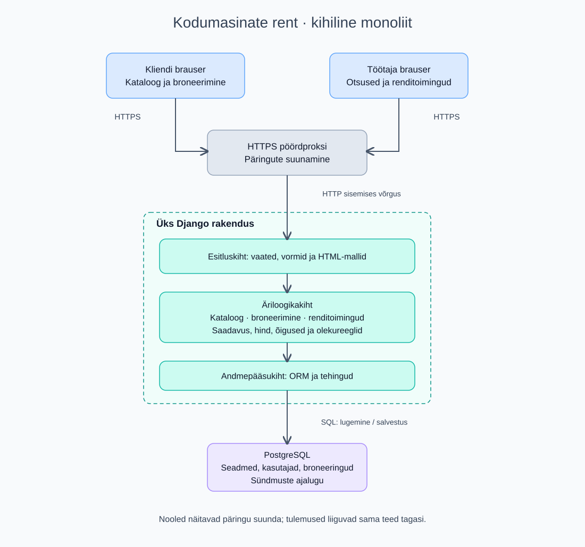

# Tarkvaraarhitektuur

## Rakenduse tüüp ja valik

Valin mobiilivaatega veebirakenduse, sest klient saab seda kasutada telefonis ja töötaja rendipunkti arvutis ilma paigalduseta. Valin **kihilise modulaarse monoliidi**: üks juurutatav Django rakendus ja üks PostgreSQL-i andmebaas. „Monoliitne” kirjeldab juurutusühikut ning „kihiline” rakenduse sisemist ülesehitust; need valikud ei välista teineteist.

Planeeritud tehnoloogiad on Python ja Django, serveris renderdatud HTML/CSS ning PostgreSQL. Django mallid võimaldavad teha põhivoo ilma eraldi Reacti rakenduse ja avaliku kliendi-API halduseta. Django autentimine ja ORM vähendavad käsitsi ehitatava tugifunktsionaalsuse hulka. Täpsed toetatud versioonid fikseeritakse arenduse alguses sõltuvuste failis.

## Skeem ja komponendid

[Muudetav lähtefail: arhitektuur.drawio](../diagrams/arhitektuur.drawio). Ava see diagrams.net-is. SVG on vaatamise eelvaade, mitte muudetava lähtefaili asendus.

| Komponent | Vastutus |
|---|---|
| Kliendi ja töötaja brauser | Vormi täitmine, kataloogi ja broneeringute kuvamine; ei otsusta ise õigusi ega saadavust |
| HTTPS pöördproksi | TLS-ühenduse lõpetamine ja päringute suunamine rakendusse |
| Esitluskiht | Django vaated, vormid ja mallid; sisendi kontroll, autentimise seostamine päringuga, HTML-vastus |
| Äriloogikakiht | Kataloogi, broneerimise ja renditoimingute moodulid; hinnareeglid, saadavus, rollid ja lubatud olekumuutused |
| Andmepääsukiht | Django ORM, tehingud ja päringud; ärireegleid toetavad andmebaasipiirangud |
| PostgreSQL | Kasutajad, seadmemudelid, eksemplarid, broneeringud, hooldusolek ja sündmuste ajalugu |

Moodulid suhtlevad rakenduse sees funktsioonikutsetega. Need ei ole eraldi serverid ega mikroteenused. E-kirja saatmise töötlus lisatakse US-11 realiseerimisel; MVP skeem ei näita seda olemasoleva komponendina.

## Andmevoog: broneeringu loomine

1. Klient avab kataloogi. Brauser saadab HTTPS GET-päringu; rakendus loeb andmebaasist aktiivsed mudelid ja tagastab HTML-lehe.
2. Klient valib mudeli ja kuupäevad. Äriloogika leiab töökorras vabad eksemplarid ja arvutab hinna. Saadavuse vaatamine ei hoia eksemplari kinni.
3. Sisselogitud klient saadab broneerimisvormi HTTPS POST-päringuga. Server kontrollib sessiooni, CSRF-kaitset, sisendeid ja kliendi õigusi.
4. Broneerimisteenus alustab andmebaasitehingut, kontrollib saadavust uuesti, eraldab eksemplari ning salvestab ootel broneeringu ja hinnasnapshot'i.
5. PostgreSQL-i kattuvust välistav piirang kaitseb sama eksemplari blokeeriva olekuga broneeringuid ka samaaegsete päringute korral. Kuupäevi käsitletakse kaasa arvatud lõppkuupäevaga vahemikuna; teostuses saab kasutada `daterange`-i ja exclusion constraint'i. Lisaks kontrollib teenus tegelikku tagastuspäeva, et ka juba tagastatud seadet ei antaks samal päeval uude renti. Eksemplari broneerimise ja tagastamise muudatused kasutavad sama rea lukustamist. Vajalikud laiendused ja migratsioon kontrollitakse EN-01/US-03 käigus. Konflikti korral tehing tühistatakse ning kasutaja saab uue valiku teha.
6. Edu korral lõpetatakse tehing ja klient suunatakse kinnituse vaatesse. Töötaja näeb sama broneeringut oma töölaual. Hilisem kinnitamine, väljastamine ja tagastamine läbivad sama kihilise tee.

Brauseril puudub otsene ühendus andmebaasiga. Töötaja toimingute õigusi kontrollitakse serveris; nupu peitmine brauseris ei ole õiguste kontroll.

## Peamised andmeobjektid

| Objekt | Näidisväljad ja seosed |
|---|---|
| Kasutaja | id, nimi, e-post, telefon, rollid; üks klient võib teha mitu broneeringut |
| Seadmemudel | id, nimetus, kirjeldus, päevahind, aktiivsus; ühel mudelil mitu eksemplari |
| Seadmeeksemplar | id, mudeli_id, inventarinumber, tehniline_olek (töökorras/hoolduses/arhiveeritud) |
| Broneering | id, kliendi_id, eksemplari_id, algus, lõpp, päevahinna_snapshot, koguhind, olek, väljastusaeg, tagastusaeg, tasutud_summa, makseviis |
| Sündmus | id, broneeringu_id või eksemplari_id, tegija_id, aeg, tegevus, põhjendus või seisukorra märkus |

Rendis või vaba olemine tuletatakse broneeringutest; seda ei hoita teise sõltumatu tõena eksemplari tehnilises olekus. See vähendab vastuoluliste seisundite riski.

Broneeringu põhiolekud: **ootab kinnitamist → kinnitatud → väljastatud → tagastatud**. Ootel taotluse saab tagasi lükata; ootel või kinnitatud broneeringu saab reeglite piires tühistada. „Hilinenud” on väljastatud broneeringu arvutatud tunnus, kui lõppkuupäev on möödas ja tagastus puudub.

## Eelised, puudused ja alternatiiv

| Aspekt | Valitud kihiline monoliit | Alternatiiv: mikroteenused |
|---|---|---|
| Arendus ja käitamine | Üks rakendus lihtsustab väikese meeskonna tööd ja veaotsingut | Teenused vajavad eraldi juurutamist, jälgimist ja liideseid |
| Broneeringu terviklus | Saadavuse kontroll ja salvestus ühes andmebaasitehingus | Mitme teenuse ja andmebaasi vahelise kooskõla tagamine on keerukam |
| Skaleerimine | Rakendust skaleeritakse peamiselt tervikuna; andmebaas võib saada kitsaskohaks | Teenuseid saab vajaduse järgi eraldi skaleerida |
| Muudatused ja vead | Ühe mooduli viga võib mõjutada kogu rakendust; muudatus vajab ühise rakenduse väljalaset | Hea eraldatuse korral saab teenuseid iseseisvalt välja lasta, kuid lisanduvad võrguvead ja lepingute haldus |

Väikese rendiettevõtte puhul ei õigusta mikroteenuste lisakeerukus nende eeliseid. Moodulipiirid hoiame siiski selged, et näiteks teavitused saaks vajaduse tekkimisel eraldada. Eraldamine eeldab mõõdetud vajadust, mitte üksnes kasutajate arvu kasvu oletust.

## Juurutus ja hooldus

Test- ja tootmiskeskkond on eraldi. Koodi hoitakse GitHubis, saladusi keskkonnamuutujates; kohalikus arenduses võib kasutada konteineritega rakendust ja andmebaasi. GitHub Actionsi kavandatud kontroll käivitab testid ja migratsioonide kontrolli. Tootmisse avaldamine toimub pärast ülevaatust ja piloodi otsust. Neid keskkondi ja töövooge ei ole kodutöös päriselt üles seatud.

Jälgitakse serverivigu, ebaõnnestunud broneeringuid ja aeglasi päringuid; logidesse ei kirjutata paroole ega kogu vormisisu. Varukoopiat tehakse iga päev ja taastamist proovitakse enne pilooti. Ebaõnnestunud väljalaske korral peatatakse uued broneeringud, hinnatakse migratsiooni tagasipööratavust ning taastatakse sobiv kood ja vajadusel andmed kokkulepitud plaani järgi. Pelgalt vana koodi käivitamine ei pruugi pärast andmebaasimuudatust piisata.

Tehnilised allikad: [Django dokumentatsioon](https://docs.djangoproject.com/), [PostgreSQL-i vahemikud ja kattuvust välistavad piirangud](https://www.postgresql.org/docs/current/rangetypes.html). Tehnoloogiate sobivus sellele projektile on kavandamisotsus.
